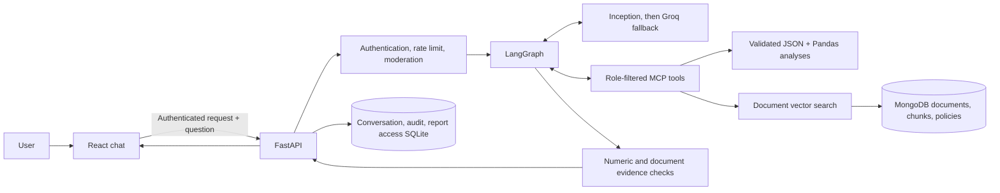

# Business Analyst AI: Application Workflow

This guide describes the application as it is implemented in the current
checkout. It covers the browser experience, backend request path, analysis and
document-search tools, access controls, evidence checks, persistence, reports,
and local Windows run steps.

> **Data note:** The supplied customers, orders, employees, documents, and
> reports are synthetic demonstration data. They do not describe a real
> business or real people.

## 1. What the application does

The application is a role-aware business analyst. A user asks a natural
language question; the application decides whether it needs structured
business data, recorded documents, or both; it calls a small set of approved
tools; and it returns an answer with evidence, sources, and caveats.

The current interactive application consists of:

- **React and Vite frontend** under [`frontend/`](./frontend/), including the
  sign-in form, chat, saved conversations, charts, evidence details, and report
  download cards.
- **FastAPI backend** in [`main.py`](./main.py), which authenticates users,
  checks requests, runs the question workflow, and serves reports.
- **LangGraph agent workflow** in [`app/graph.py`](./app/graph.py), which
  selects and calls tools, checks the resulting answer, and stops when the
  evidence or workflow limits require it.
- **Two local MCP subprocesses**: the business-data server and the
  document-search server. The backend starts and closes these for a question;
  they are not separately launched by the developer.
- **Local JSON business datasets**, MongoDB documents, embedded chunks, and
  runtime policies; SQLite remains responsible for conversations, audit
  events, and report ownership.
- **External model services**: Inception is the primary chat model when
  configured, Groq is its fallback (or can run alone), and Mistral supplies
  document embeddings.



The models do not receive arbitrary Python execution or unrestricted database
access. They request specifically declared tools, and the tool implementations
validate parameters and apply role policy.

## 2. What happens when a user asks a question

### A. Sign-in and session setup

1. The browser sends the username and password to `POST /auth/login`.
2. The backend checks the configured demo-user store and verifies the password
   against its Argon2id hash. A successful login returns a signed bearer token
   that expires after 30 minutes.
3. The frontend calls `GET /me` with that token to verify the identity and
   obtain the account's role. It stores the authenticated session in
   `sessionStorage`. A missing, invalid, or expired token returns the user to
   sign-in.
4. The frontend's Vite development server forwards `/api/...` requests to
   FastAPI at `http://127.0.0.1:8000`, removing the `/api` prefix.

The plaintext demo passwords are not stored in the repository. Use the
credentials provided with the development handover; do not expect the
passwords to be recoverable from the hashes.

### B. Browser submits a chat turn

1. The chat hook trims the question, adds it to the visible conversation, and
   sends `POST /ask` with the question and (for an existing chat) its
   `conversation_id`.
2. The API requires a valid bearer token and applies a per-user rolling rate
   limit. The current limit is 20 `/ask` requests per minute. Login attempts
   are also rate-limited per username.
3. The backend claims or verifies ownership of the conversation ID. A user
   cannot continue another user's conversation. It loads a bounded amount of
   recent conversation text and the successful tool/document evidence from
   recent turns, so relevant follow-up questions can reuse earlier evidence.
4. Input moderation runs before the model. A matching refusal rule returns a
   refusal response (`moderation.status` is `refused`) without starting the
   model workflow. The API returns that moderation result as a normal response
   rather than an HTTP error; the decision is audited.

### C. The backend prepares the analyst

1. The backend loads and validates the server configuration. It requires a
   Mistral key for document-search initialization and at least one chat-model
   key (Inception or Groq).
   Both local MCP servers are initialized for a question. In MongoDB mode,
   MongoDB must be running and seeded even when a question only needs
   structured business data. The legacy JSON vector store is used only when
   `MONGODB_ENABLED=false`.
2. It builds the Inception-first/Groq-fallback chat model.
3. It starts the two MCP servers as local stdio subprocesses and passes the
   verified user ID and role as tool-call metadata.
4. The MCP client loads the access policy and only exposes tools that the
   user's role is allowed to use. The tool servers also enforce permissions
   when a tool is called; hiding a tool from the model is not the only check.
5. The graph receives the system and answer-format instructions, the current
   question, recent conversation text, and relevant saved evidence. The graph
   has bounded tool-call and retry budgets, configured by `MAX_STEPS` and
   `MAX_RETRIES`.

### D. The model chooses a route and tools

The model is instructed to use the schema and approved tools rather than
inventing calculations:

- **Structured-data question:** use `get_data_schema` when it needs to discover
  fields, supported analyses, glossary definitions, or the configured date
  anchor. Use `query_business_data` for simple record lookups and exact dataset
  counts. Use `run_analysis` for the named calculations.
- **Document question:** call `search_documents` before answering. The graph
  supplies the user's original question as the search query. If the user
  specifies a document type or date, the model can request those filters.
- **Combined question:** retrieve the measured figure with a data analysis and
  retrieve the recorded explanation with document search. The final answer
  must keep the measured result separate from the document's reported
  explanation; a reported explanation is not proof of causation.
- **Ambiguous question:** the model can call an internal clarification action.
  The graph returns one concise question and ends that run rather than
  guessing which metric or period the user meant.
- **Chart or report request:** the graph makes the report tool available only
  when the question appears to request a report. A chart request is handled
  separately from a report request.

The workflow runs a tool, adds its result to the graph state, and lets the
model inspect that result before deciding what to do next. Multiple tool calls
may be needed for one question. Every tool call counts against the configured
step cap. Tool failures are recorded and may be retried while the workflow
budget remains.

### E. Structured business-data path

The business-data MCP server loads the configured JSON datasets into validated
in-memory Pandas data frames. It rejects malformed records, invalid field
types, duplicate keys where keys must be unique, and broken relationships.
Queries return copies and do not write to the source datasets.

The included datasets are:

| Dataset | Typical contents |
|---|---|
| `customers` | Customer name, region, and segment |
| `products` | Product name and category |
| `orders` | Customer, order date, and order status |
| `order_items` | Product, quantity, and unit price in cents |
| `employees` | Department and employment attributes, subject to role policy |

`query_business_data` supports validated field selection, filters, date ranges
for orders/order items, sorting, row caps, and grouping. It returns
`total_matches` separately from `returned_rows`; the returned rows can be
capped, so the model is instructed to use `total_matches` for exact row
counts. Query limits are bounded.

`run_analysis` dispatches named, deterministic Pandas implementations. The
analyses currently in the schema and dispatcher are:

- `revenue_by_product` and `revenue_by_category`
- `revenue_by_period` and `period_change`
- `top_customers`
- `trend` and `outliers`

Sales calculations join order items to orders, products, and customers.
Revenue is quantity multiplied by unit price and represented in integer cents.
Only completed orders are included. Trend is a least-squares slope over the
observed periods; an outlier is more than two population standard deviations
from the selected range's mean. Analysis results include their date periods
and assumptions.

### F. Document-search path

Documents are listed in `data/documents/manifest.json`, which provides their
department, classification, type, and date. Ingestion reads the listed PDF,
text, and Markdown files, splits the extracted text into overlapping
character chunks, embeds those chunks with Mistral, and stores both the
extracted source text and chunks in MongoDB when `MONGODB_ENABLED=true`. The
`access_control` and `moderation_rules` policy documents are stored separately
in MongoDB; authentication users remain in the local `users.json` file.

Run `.\.venv\Scripts\python.exe -m scripts.ingest_mongodb` from the repository
root to ingest or refresh the checked-in sample corpus. This includes the
additional fictional policy and sales-note examples. The script needs a
running MongoDB instance and a valid `MISTRAL_API_KEY`.

For a search, the retriever:

1. Filters candidate chunks by the user's document permissions and any
   requested type/date filters.
2. Embeds the question with the configured Mistral embedding model.
3. Ranks candidates by cosine similarity, returns up to `TOP_K` chunks, and
   excludes results below `MIN_SIMILARITY`.
4. Returns passage text and source metadata, including the original document
   filename and (for PDFs) page number.

Candidate chunks are filtered by the same access policy before ranking.
Cosine similarity is still computed in process; the MongoDB migration does not
depend on Atlas Vector Search. Before retrieved text reaches the model,
moderation drops passages that match configured prompt-injection patterns.
Retrieved text is treated as data, not instructions. The answer instructions
require document-derived factual claims to include the exact filename and an
exact supporting quote.

### G. Evidence check and final answer

When the model drafts an answer, the graph checks its numeric claims against
successful tool results and its document claims against retrieved passages.
Checks include numerical support, metric/unit context, document citations and
quotes, and wording that could incorrectly claim causation. The graph also
checks that a requested chart has usable results and that a requested report
was actually generated when supporting data exists.

- If the draft passes, the graph finalizes it.
- If it fails and retry budget remains, the model gets another opportunity to
  correct or supplement the answer.
- If the checks still fail, the application fails closed: it avoids presenting
  unsupported draft claims as facts, and may provide relevant passages or
  structured results with an explicit explanation.
- If the step limit is reached or a tool fails, the answer can include a
  caveat about incomplete evidence.

These are deterministic guardrails, not a guarantee that every valid answer
will be accepted or that every unsupported claim will be caught. A successful
HTTP status means the request was handled; it does not by itself mean that a
complete factual answer was possible.

### H. Moderation, storage, and response

After graph finalization, output moderation checks the candidate response for
configured sensitive content and restricted material. If content must be
redacted, the frontend receives a generic withholding notice rather than the
candidate answer, figures, charts, and sources. A report produced for a
redacted response is removed where possible.

For a non-redacted response, the API returns:

- `answer` and `conversation_id`
- tool-backed `figures`, chart specifications, and `sources`
- relevant `caveats`
- a moderation status (`ok`, `redacted`, or `refused`)
- `report_filename` if a downloadable report was generated

Completed turns and successful evidence are stored in the SQLite conversation
database, subject to the configured history limit; this conversation store
contains the question and answer text. The frontend separately keeps recent
conversation UI state in browser storage. Audit events go to the configured
audit SQLite file; question text is hashed rather than stored as plain text in
the audit event. The `/audit` API is restricted to administrators.

The frontend renders the answer, evidence panel, and any returned charts. If a
report is available, it displays a download card. A download uses the authenticated
report endpoint; the backend serves only registered reports from MongoDB or
the validated legacy local directory, and allows access to the report's owner
or an administrator.

## 3. Role-based access

The checked-in policy seed is
[`data/policy/access_policy.json`](./data/policy/access_policy.json). The
ingestion script stores it as the `access_control` policy in MongoDB, where it
is loaded and validated in MongoDB mode. It combines tool permissions,
dataset/field classifications, department and document classifications,
analysis permissions, and (where configured) minimum group sizes. Both the
MCP client and the MCP tools apply these rules. Moderation rules are likewise
seeded from `data/policy/moderation_rules.json`.

| Role | Current policy intent |
|---|---|
| `sales` | Sales datasets and named sales analyses; sales/general documents; sales reports and charts. |
| `hr` | Employee data, including fields classified as restricted by the dataset policy, and HR/general documents, including HR-restricted documents. |
| `manager` | Sales analysis plus limited employee aggregates; employee queries are aggregate-only, restricted to department/tenure-band groupings, with a minimum group size of five. |
| `admin` | Administrative/audit permissions. The current policy does not grant the admin role the business-analysis or document tools. |

Field-level classifications further restrict access. For example, employee
salary, performance rating, work email, and phone are classified as restricted.
The current HR policy permits those restricted employee fields; the manager
policy does not.
Manager employee queries are narrower than HR queries: the configured
manager dataset rule allows only department and hire-date fields and requires
aggregation. Do not treat a role's display name or the model's tool selection
as an access-control mechanism; the policy checks are authoritative.

## 4. Charts and downloadable reports

**Charts:** The graph asks for an analysis that yields a useful ranking,
comparison, or multiple periods. The backend builds chart specifications from
successful analysis results and sends them to the frontend for rendering. A
single total may not contain enough information to make a useful chart.

**Reports:** A report request enables `generate_report`. The model must provide
a structured report object whose figures refer to successful tool-call
evidence. The backend validates the report schema and checks its numeric claims
against the cited tool results before rendering an editable DOCX into
`reports/`. The API uploads the generated DOCX to MongoDB GridFS and writes
the registered owner record to SQLite before the report can be downloaded.
Older registered reports can still be served from the local `reports/`
directory if they have not yet been uploaded.

## 5. Run the application on Windows

Run these commands from the repository root in PowerShell. The backend and
frontend need separate terminals.

### One-time setup

1. Create and activate the Python environment, then install backend
   dependencies:

   ```powershell
   py -m venv .venv
   .\.venv\Scripts\Activate.ps1
   python -m pip install --upgrade pip
   pip install -r requirements.txt
   ```

2. Install frontend dependencies:

   ```powershell
   Push-Location frontend
   npm install
   Pop-Location
   ```

3. Create the private environment file and add API keys:

   ```powershell
   Copy-Item .env.example .env
   notepad .env
   ```

   Set `MISTRAL_API_KEY` and at least one of `INCEPTION_API_KEY` or
   `GROQ_API_KEY`. Inception is used first when configured; Groq is the
   fallback. For MongoDB mode, keep `MONGODB_ENABLED=true`, set `MONGODB_URI`
   and `MONGODB_DATABASE`, and configure a reachable MongoDB Atlas deployment.
   In Atlas, allow the machine's IP in Network Access and create a database
   user; replace the URI placeholders in `.env` and URL-encode special
   characters in credentials. Mistral is needed for document search and
   ingestion. Keep `.env` private and do not commit secrets.

4. Set a JWT signing secret of at least 32 bytes. Either add a private
   `JWT_SECRET_KEY` value to `.env`, or generate a temporary key in the
   **backend terminal** before starting the server:

   ```powershell
   $env:JWT_SECRET_KEY = & .\.venv\Scripts\python.exe -c "import secrets; print(secrets.token_urlsafe(48))"
   ```

   A temporary key is sufficient for a local session, but tokens issued with
   it will not survive restarting the backend with a different key.

5. In MongoDB mode, seed or refresh source documents and policies after
   configuring MongoDB:

   ```powershell
   .\.venv\Scripts\python.exe -m scripts.ingest_mongodb
   ```

   Ingestion calls the Mistral embeddings API and can use API quota. Rerun it
   after changing documents or policy seed files. If you explicitly set
   `MONGODB_ENABLED=false`, the legacy JSON ingestion command remains available:
   `.\.venv\Scripts\python.exe -m app.rag.ingest`.

### Start the web application

1. **Backend terminal**, at the repository root. Set the temporary JWT key
   here first if you did not put one in `.env`:

   ```powershell
   .\.venv\Scripts\python.exe -m uvicorn main:app --reload
   ```

   The API is at `http://127.0.0.1:8000`. FastAPI's interactive API page is
   `http://127.0.0.1:8000/docs`.

2. **Frontend terminal**, also at the repository root:

   ```powershell
   npm --prefix frontend run dev
   ```

3. Open the Vite URL printed in the frontend terminal, normally
   `http://localhost:5173`, and sign in with a demo account from the
   development handover. The Vite proxy forwards browser API requests to the
   backend.

4. Ask a question supported by your account's role and the supplied data. For
   example, a sales account can ask for completed-order revenue in a specified
   period. Use an explicit time range when the question depends on dates.

The MCP servers start automatically when a question is processed. Do not open
separate terminals for them. To stop the application, press **Ctrl+C** in the
frontend and backend terminals.

### Optional one-question CLI

The project also has a Python CLI for a single question:

```powershell
.\.venv\Scripts\python.exe -m app.cli "What was completed-order revenue in November 2024?"
```

It prompts for a demo username and password. It uses the same model, MCP
tools, role policy, graph, and input moderation, but it does not provide the
web API's multi-turn conversation persistence, output-moderation, or
owner-registered report-download flow. Use the web application when you want
the complete interactive experience described above.

### Optional API check

The protected API can also be used without the React frontend. First obtain a
token through `POST /auth/login`, then send it as a bearer token to
`POST /ask`. The frontend performs these steps for you. See the authentication
and API examples in [`README.md`](./README.md); note that `/ask` requires
authentication in the current application.

## 6. Troubleshooting

| Symptom | Likely cause / next step |
|---|---|
| Login reports authentication is not configured | Set `JWT_SECRET_KEY` to at least 32 bytes and restart the backend. |
| Login fails with invalid credentials | Use the matching demo username/password from the development handover. The repository stores password hashes, not plaintext passwords. |
| Frontend shows a network/proxy error | Confirm the backend is running on port 8000, then refresh the Vite page. |
| Question workflow says it is not configured | Add `MISTRAL_API_KEY` and at least one chat-model key, then restart. |
| Document search cannot load its corpus | In MongoDB mode, confirm the Atlas URI and run `python -m scripts.ingest_mongodb`; in legacy mode, build the JSON store with `python -m app.rag.ingest`. |
| Access policy or moderation is unavailable | In MongoDB mode, run the ingestion script and verify the `access_control` and `moderation_rules` policy documents exist. |
| Model answers are refused, redacted, or cannot verify a claim | Check the moderation status and caveats in the response. A refusal/redaction is an intentional control; evidence failures can mean the available tools did not support the draft. |
| API returns 429 | Wait for the `Retry-After` delay; the current limit is 20 questions per user per rolling minute. |
| Report card is absent | The question may not have explicitly requested a report, the role may lack permission, evidence validation may have failed, or report generation may have hit a workflow limit. |

For offline tests that do not call the model providers, follow the test command
in [`README.md`](./README.md).

## 7. Current implementation caveat

The policy and starter-question configuration currently mention `headcount`
and `decline_risk`, but those names are not in the business-data schema's
`AVAILABLE_ANALYSES` or the dispatcher in
[`app/analysis/analyses.py`](./app/analysis/analyses.py). The frontend also
suggests questions using those names. As a result, do not assume those
analyses are currently runnable just because a role policy or starter prompt
mentions them. This is a configuration/implementation mismatch to resolve
before relying on those use cases.

## 8. Source map

| Concern | Main implementation |
|---|---|
| HTTP routes, orchestration, response shaping | [`main.py`](./main.py) |
| Agent graph, tool loop, evidence retry/finalization | [`app/graph.py`](./app/graph.py) |
| Role policy and MCP identity | [`app/policy/`](./app/policy/) |
| User login and bearer tokens | [`app/auth/`](./app/auth/) |
| Business-data tools and report creation | [`app/mcp_servers/business_data_server.py`](./app/mcp_servers/business_data_server.py) |
| Dataset schema, validation, and analyses | [`app/data_access/`](./app/data_access/) and [`app/analysis/`](./app/analysis/) |
| Document ingestion and retrieval | [`app/rag/`](./app/rag/) and [`app/mcp_servers/rag_server.py`](./app/mcp_servers/rag_server.py) |
| MongoDB document, policy, and report storage | [`app/mongodb.py`](./app/mongodb.py), [`scripts/ingest_mongodb.py`](./scripts/ingest_mongodb.py) |
| Numeric and document evidence | [`app/services/evidence_check.py`](./app/services/evidence_check.py) |
| Moderation rules and enforcement | [`app/moderation/`](./app/moderation/) |
| Conversation, audit, report access | [`app/conversation_store.py`](./app/conversation_store.py), [`app/audit_log.py`](./app/audit_log.py), [`app/report_access.py`](./app/report_access.py) |
| Frontend auth and conversation request flow | [`frontend/src/App.jsx`](./frontend/src/App.jsx), [`frontend/src/auth/`](./frontend/src/auth/), [`frontend/src/hooks/useConversation.js`](./frontend/src/hooks/useConversation.js) |
