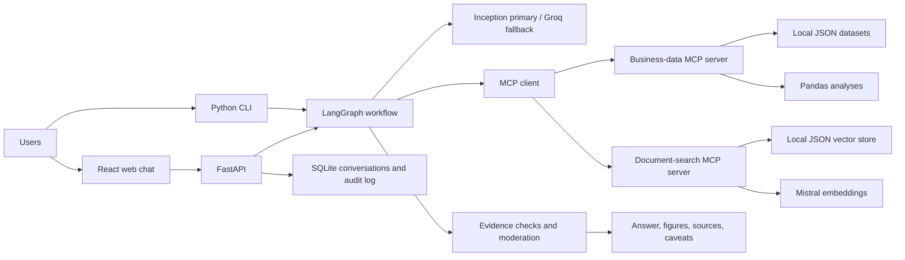

# Business Analyst AI — Project Summary

## Project summary

Business Analyst AI is a conversational assistant for asking questions about
synthetic business data and documents. It returns evidence-checked answers,
figures, sources, and caveats through a command-line interface, HTTP API, and
React chat frontend.

## Problem statement

Business information is often spread across structured datasets and written
reports, making it slow to answer operational questions and verify the
supporting evidence. This project provides a single natural-language interface
while limiting analysis to approved tools and checking that answers are
grounded in available evidence.

## Project objectives

- Answer business questions using read-only, approved data and document tools.
- Run named analyses over synthetic datasets and retrieve relevant document
  passages.
- Check numerical and document-based claims before returning answers.
- Enforce account roles and moderate requests and responses.
- Provide conversational access through the CLI, API, and web interface.
- Keep supporting figures, sources, caveats, and report downloads accessible.

## Intended users

- **Sales users** — ask permitted questions about sales and customers.
- **HR users** — ask permitted questions about employee-related information.
- **Managers** — review approved business analysis and permitted aggregates.
- **Administrators** — manage administrative functions such as reviewing audit
  events.
- **Developers and evaluators** — run the application, test its behavior, and
  assess answer quality.

## High-level architecture

The workflow selects from constrained MCP tools rather than executing
arbitrary queries or code. Business analyses use approved datasets; document
search uses retrieved passages. Evidence checks and moderation are applied
before answers are returned.

## Tech stack

| Area | Technologies |
|---|---|
| Backend and API | Python, FastAPI, Uvicorn |
| Agent workflow | LangGraph, LangChain |
| Tool integration | Model Context Protocol (MCP) |
| Business data | JSON, Pandas, NumPy |
| Document search | Mistral embeddings, local JSON vector store |
| Language models | Inception (primary), Groq (fallback) |
| Persistence and authentication | SQLite, JWT, Argon2 |
| Web frontend | React, Vite, JavaScript |
| Reports and charts | python-docx, Matplotlib |
| Testing | pytest |
