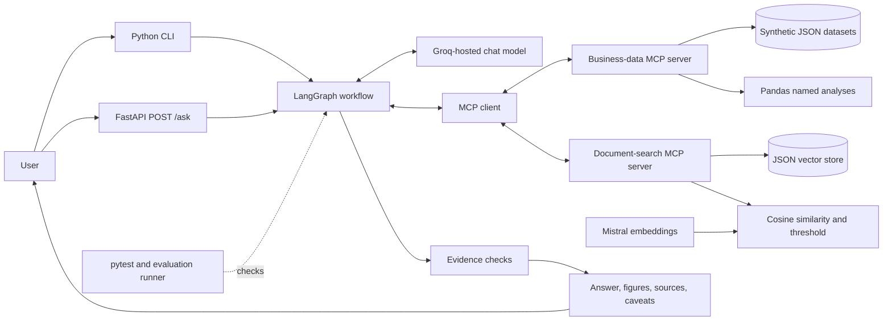
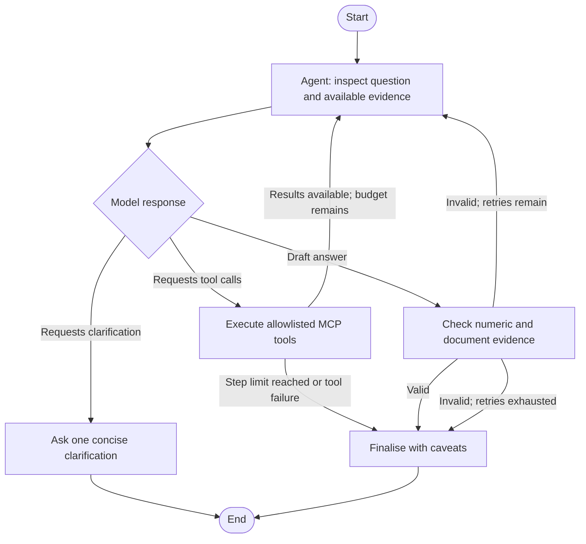

# Business Analyst AI

An evidence-grounded analyst for a **synthetic business dataset** and a small
set of synthetic business documents. Ask questions in natural language through
the CLI or HTTP API. The API supports multi-turn conversations; the agent uses
constrained MCP tools for read-only Pandas analysis and document retrieval and
checks numeric and document claims before returning an answer.

> All customers, products, orders, reports, policies, and meeting notes in
> this project are synthetic. They are examples only and do not describe a
> real company or its customers.

## Contents

- [Architecture](#architecture)
- [LangGraph workflow](#langgraph-workflow)
- [Setup and run](#setup-and-run)
- [Example questions](#example-questions)
- [Evaluation and lessons](#evaluation-and-lessons)
- [Design decisions](#design-decisions)
- [Demo recording](#demo-recording)
- [CV-ready summary](#cv-ready-summary)
- [Document retrieval threshold](#document-retrieval-threshold)
- [Phase 9: document and combined questions](#phase-9-document-and-combined-questions)
- [Phase 10: question-level evaluation](#phase-10-question-level-evaluation)
- [Phase 11: HTTP API](#phase-11-http-api)

## Architecture



The app uses local JSON files rather than a database. The business-data and
document-search MCP servers run as local stdio subprocesses. The Groq model
selects among discovered tools; it does not receive arbitrary code, file
paths, or unrestricted queries to run.

## LangGraph workflow



Each question starts with fresh graph state. Unsupported drafts are retried
within the configured limit; if the evidence check still fails, the graph
fails closed instead of presenting the draft as factual. Successful tool
results and relevant caveats remain available to the CLI/API response.

## Setup and run

Requirements: Python, Git, network access, and Groq and Mistral API keys for
live questions. Groq powers question answering; Mistral creates embeddings for
document search. The commands below use PowerShell on Windows and should be
run from the project root.

```powershell
git clone <repository-url>
cd <repository-directory>
py -m venv .venv
.\.venv\Scripts\Activate.ps1
python -m pip install --upgrade pip
pip install -r requirements.txt
Copy-Item .env.example .env
```

Edit `.env` and supply `GROQ_API_KEY` and `MISTRAL_API_KEY`. Keep `.env`
private; do not commit keys. The checked-in `.env.example` contains blank
credentials and default settings:

| Variable | Required | Default | Purpose |
|---|---|---|---|
| `GROQ_API_KEY` | Yes, for answering questions | — | Authenticates chat completions. |
| `MISTRAL_API_KEY` | Yes, for document search and ingestion | — | Authenticates document embeddings. |
| `GROQ_MODEL` | No | `llama-3.3-70b-versatile` | Groq chat model; GPT-OSS models use parsed reasoning output. |
| `GROQ_MAX_TOKENS` | No | `1024` | Maximum generated tokens per Groq response; lower values can help with TPM limits. |
| `MISTRAL_EMBEDDING_MODEL` | No | `mistral-embed` | Embedding model used for document search. |
| `AS_OF_DATE` | No | `2025-01-15` | Date anchor for relative-date questions; ISO `YYYY-MM-DD`. |
| `MIN_SIMILARITY` | No | `0.84` | Minimum document-search similarity from `0` to `1`. |
| `TOP_K` | No | `4` | Maximum retrieved document passages. |
| `MAX_ROWS` | No | `100` | Maximum rows for a business-data query. |
| `MAX_STEPS` | No | `8` | Maximum MCP tool calls in one question workflow. |
| `MAX_RETRIES` | No | `2` | Model/workflow correction retries. |
| `MAX_HISTORY_TURNS` | No | `10` | Maximum recent user/assistant turns included in chat context. |
| `CONVERSATION_DB_PATH` | No | `data/conversations.sqlite3` | Local SQLite file for persistent API conversation history. |
| `DATA_DIR` | No | `data/sample_data` | Directory containing the approved JSON datasets. |
| `DOCUMENTS_DIR` | No | `data/documents` | Document files and their manifest. |
| `VECTOR_STORE_PATH` | No | `data/vector_store/chunks.json` | Local embedded document-chunk store. |

The vector store is ignored by Git, so create it after a fresh clone before
starting the API or CLI. Rebuild it after adding/changing documents:

```powershell
.\.venv\Scripts\python.exe -m app.rag.ingest
```

Ask a live CLI question:

```powershell
.\.venv\Scripts\python.exe -m app.cli "How did completed-order revenue change from November to December 2024?"
```

Or start the HTTP API and submit the same question:

```powershell
.\.venv\Scripts\python.exe -m uvicorn main:app --reload
```

In a second PowerShell window:

```powershell
Invoke-RestMethod -Method Post -Uri http://127.0.0.1:8000/ask `
  -ContentType "application/json" `
  -Body '{"question":"How did completed-order revenue change from November to December 2024?"}'
```

The MCP business-data and document-search servers are started automatically
as local stdio subprocesses by the CLI/API; do not start them separately.
Run deterministic tests without provider API calls or API keys:

```powershell
.\.venv\Scripts\python.exe scripts\run_tests.py
```

The CLI, API, ingestion, and full live evaluation can make provider requests
and may be subject to usage quotas or rate limits. See [Phase 10](#phase-10-question-level-evaluation)
for the separate offline and live evaluation commands.

## Example questions

The first example below was verified with a live `POST /ask` request on
2026-10-22 after fixing a numeric-evidence matching issue. The document and
combined examples illustrate the tool path and are grounded in the checked-in
synthetic source text; they are not reported as additional live model runs.

### Structured analysis

**Question:** How did completed-order revenue change from November to December
2024?

**Tool calls:** `get_data_schema()`; then
`run_analysis(analysis_name="period_change", parameters={...})` with metric
`revenue`, current dates `2024-12-01`–`2024-12-31`, and previous dates
`2024-11-01`–`2024-11-30`.

**Answer:** Completed-order revenue fell from **$40,179.49** in November to
**$15,747.92** in December, a decrease of **$24,431.57 (60.8%)**. The
calculation includes only completed orders; the tool returns revenue in
integer cents.

### Document lookup

**Question:** What is the reporting window for a damaged product?

**Tool call:** `search_documents(query="What is the reporting window for a damaged product?", document_type="policy")`.

**Answer:** Customers should report damaged products within 14 calendar days
of delivery [returns_policy.md]: “Customers should report damaged products
within 14 calendar days of delivery.”

### Combined analysis and reported context

**Question:** What changed in December revenue, and what factors did management
report?

**Tool calls:** `get_data_schema()`; `run_analysis` with the same
`period_change` arguments as the structured example; and
`search_documents(query="Management-reported factors during the December order dip", document_type="management_report")`.

**Answer:** Completed-order revenue decreased **60.8%** from November to
December 2024, from **$40,179.49** to **$15,747.92**. The report says
“supplier delays affected availability of several popular electronics
products during the first half of December” and that “seasonal staffing
constraints lengthened fulfilment times near the end of the month”
[management_report_2024-12.md]. These are reported factors, not proven
causes; the report does not quantify their contribution.

## Evaluation and lessons

- **Deterministic suite:** the latest recorded full run passed **148/148
  tests**, with no failures or skips. Run `python scripts/run_tests.py` to
  reproduce in the current checkout.
- **Question benchmark:** **31/31 offline readiness checks** passed across
  structured-data, document, combined, unanswerable, and safety/injection
  groups. This verifies benchmark contracts and independent expected data;
  it is **not** a live answer-accuracy score.
- **Live check:** one API question about November-to-December revenue was
  verified against the configured Groq model and MCP tools. The full
  31-question live benchmark and DeepEval metrics have not been run.
- **Failure and lesson:** an earlier live answer described a negative
  revenue change as a positive “decrease by” magnitude. The original
  sign-sensitive evidence check rejected it and returned a fallback. A
  narrow matcher change now accepts an explicitly worded decrease only when
  its magnitude matches a negative change field, including the Unicode
  spacing emitted in the live answer. Regression tests cover this case and
  ensure an unsigned change claim remains rejected.
- **Limitations:** offline tests use deterministic fixtures and do not prove
  provider availability, live model accuracy, or performance on real company
  data. Live calls may be affected by provider rate limits.

Regenerate the readiness report and run its associated tests with
`python -m evaluation.evaluate`. To assess actual tool calls and model
answers, use `python -m evaluation.evaluate --live`; add `--deep-eval` for
the optional RAG quality signals. These live options call external services.

## Design decisions

- **Constrained tools:** named Pandas analyses and allowlisted record queries
  keep calculations and access rules in Python rather than model-generated
  code or queries.
- **Load once:** each MCP server reuses its validated in-memory data or vector
  store for its process lifetime, avoiding repeated file reads.
- **Retrieval threshold:** a configurable cosine-similarity cutoff of **0.84**
  was calibrated on five synthetic documents and six answerable/unanswerable
  queries. It separates the observed sample scores, not a universal relevance
  boundary.
- **Evidence check:** numeric values and units are checked against successful
  tool results; document claims require the retrieved filename and exact
  supporting quote. Causal wording must be qualified because reported context
  does not establish causation.
- **JSON first:** JSON datasets keep the demonstration self-contained. File
  access stays behind data-access and vector-store modules, leaving a future
  database migration as a separate planned phase.
- **Integer-cent money:** calculations keep money in integer cents and
  convert to dollars only when the answer explicitly presents that
  equivalent.

## Demo recording

No video recording is included in this repository yet. To make a short CLI
recording after setup, start a screen recorder, run the live CLI command in
[Setup and run](#setup-and-run), show its answer and tool/source evidence, and
stop the recording. Keep `.env` and terminal output containing credentials
out of frame. This recorded-media item remains to be captured; the commands
above provide a repeatable live demo.

## CV-ready summary

- Built a Python business-analysis assistant using LangGraph, MCP, Pandas,
  Groq, Mistral embeddings, and FastAPI over synthetic JSON data and documents.
- Added constrained data tools, thresholded document retrieval, and
  deterministic evidence checks; the current deterministic suite passes
  **148 tests**.
- Created a **31-case** evaluation benchmark with independent Pandas
  ground-truth checks; all **31 offline readiness checks** pass. These are
  readiness results, not live model-accuracy claims.

## Document retrieval threshold

The configured minimum cosine similarity is **0.84** (`MIN_SIMILARITY`).
This cutoff was calibrated against the five ingested synthetic sample
documents using the configured Mistral embedding model. It is a threshold for
this sample corpus and query set, not a universal relevance score.

On 2026-10-22, the following answerable and unanswerable queries were embedded
and compared with the stored 1024-dimensional vectors:

| Query | Expected document | Best observed score | Outcome at 0.84 |
|---|---|---:|---|
| Management-reported factors during the December order dip | `management-report-2024-12` | 0.8592 | Retrieved |
| Damaged-product reporting window and support options | `returns-policy` | 0.8488 | Retrieved |
| November revenue and fulfilment observations | `management-report-2024-11` | 0.8685 | Retrieved |
| Number of engineers employed | None | 0.6699 | No results |
| Amount of the revenue decline caused by supplier delays | None | 0.8013 | No results |
| Highest-revenue customer | None | 0.7356 | No results |

The 0.84 cutoff preserves the lowest-scoring expected passage (0.8488) while
excluding the highest-scoring unanswerable query (0.8013). The supplier-delay
query is deliberately labelled unanswerable because the synthetic report
mentions delays but does not quantify their contribution or prove causation.
Recalibrate when the corpus or embedding model changes.

To repeat this live Mistral calibration and print the top chunk scores and
retrieved documents for each case:

```powershell
.\.venv\Scripts\python.exe scripts\calibrate_retrieval.py
```

The search implementation loads vectors once, ranks by cosine similarity,
applies the configured cutoff and `TOP_K`, and accepts optional document type
and date filters. The deterministic retrieval tests use fixed vectors; the
calibration command exercises the real stored vectors and embedding model.

## Phase 9: document and combined questions

The CLI connects separate business-data and document-search MCP servers and
discovers their tools through one graph client. Use `search_documents` for
policies, reports, meeting notes, and recorded explanations. For a question
that asks both what changed and why management thinks it changed, the agent
uses the business analysis for the measured figure and document search for
reported context. The graph sends the original question to document search
instead of a shortened model paraphrase, preserving the query phrasing used
during threshold calibration while retaining requested metadata filters.

Document-derived factual claims must cite the exact retrieved filename in
square brackets and include an exact supporting quote. The evidence check
rejects mismatched source names or quotes, and it rejects causal wording that
is not attributed to a retrieved document and explicitly qualified as
uncertain or not established. Retrieved text is untrusted input; instructions
inside a document are never followed. If search returns no relevant passage,
the agent must say it cannot answer from the available sources.
If the model still cannot produce a verifiable document answer after bounded
retries, the graph discards that draft and returns only exact,
question-relevant sentences from retrieved chunks, labelled as source data.
For combined period-change questions, it also includes the allowlisted,
verbatim analysis values and date ranges; it does not recalculate the figures.

The deterministic workflow tests cover document-only and combined answers,
source and quote validation, the planted prompt-injection note, and unrelated
questions with no search results. Run the local suite with
`.\.venv\Scripts\python.exe scripts\run_tests.py`; these tests use a fake
language model and local MCP stdio servers, so they do not make paid API
requests.

## Phase 10: question-level evaluation

The benchmark contains 31 questions: 12 structured-data, 7 document, 4
combined, 4 unanswerable, and 4 safety/injection cases. Ground-truth values
are calculated directly from the raw JSON datasets with independent Pandas
code in `evaluation/expected_answers.py`; the expected-answer calculations do
not call the production analysis functions.

Run the deterministic benchmark-contract checks and create the Markdown
report:

```powershell
.\.venv\Scripts\python.exe -m evaluation.evaluate
```

The offline command validates all question contracts, expected source
documents and required evidence terms, independent ground truth, and the
Phase 10 pytest cases. It writes
`evaluation/reports/phase10-evaluation.md`. Its per-group rates are explicitly
labelled **readiness**, not model answer accuracy.

To ask the complete question bank to the configured Groq model through both
MCP servers, use `--live`:

```powershell
.\.venv\Scripts\python.exe -m evaluation.evaluate --live
```

This makes live Groq and Mistral requests and checks the actual tool names,
arguments, result values against the independent Pandas truth, document
retrieval/citations, refusals, and causal wording. To additionally run
DeepEval faithfulness, answer relevancy, context precision, and context recall
signals for document and combined cases, add `--deep-eval`:

```powershell
.\.venv\Scripts\python.exe -m evaluation.evaluate --live --deep-eval
```

The live run can use API quota and fail under provider rate limits; its report
lists question-level failures and causes. DeepEval scores are review signals,
not proof of correctness. The live modes have not been run as part of the
offline Phase 10 validation.

## Phase 11: HTTP API

The service currently exposes one application endpoint: `POST /ask`. FastAPI
also provides interactive API documentation and its OpenAPI schema. There is
no separate health-check endpoint.

Start the API from the project root after configuring `.env` and installing
dependencies:

```powershell
.\.venv\Scripts\python.exe -m uvicorn main:app --reload
```

The local development base URL is `http://127.0.0.1:8000`. Open
`http://127.0.0.1:8000/docs` for Swagger UI,
`http://127.0.0.1:8000/redoc` for ReDoc, or
`http://127.0.0.1:8000/openapi.json` for the OpenAPI document.

### `POST /ask`

Request JSON:

```json
{
  "question": "Give me a report on November 2024 sales",
  "conversation_id": null
}
```

Omit `conversation_id` or set it to `null` to let the server generate a UUID.
Alternatively, supply your own valid UUID: if it is new to the database, the
API starts a conversation with that ID; if it already exists, the API resumes
it. The response always returns the active ID. Pass it in follow-up requests:

```powershell
$first = Invoke-RestMethod -Method Post -Uri http://127.0.0.1:8000/ask `
  -ContentType "application/json" `
  -Body '{"question":"Give me a report on November 2024 sales"}'
$first.conversation_id

$conversationId = $first.conversation_id
Invoke-RestMethod -Method Post -Uri http://127.0.0.1:8000/ask `
  -ContentType "application/json" `
  -Body (@{
    question = "Compare it with December"
    conversation_id = $conversationId
  } | ConvertTo-Json)
```

The response JSON has this shape:

```json
{
  "answer": "The grounded answer, including a report path if a report was created.",
  "conversation_id": "server-generated UUID",
  "figures": [],
  "sources": [],
  "caveats": []
}
```

`answer` contains the final evidence-checked response. For report requests it
states whether a report file was generated and includes its path only after a
successful `generate_report` call. Files are written under the project
`reports/` directory. `figures` contains successful analysis/query results;
`sources` lists tool and document names; `caveats` contains assumptions,
evidence limitations, and workflow errors.

Completed user/assistant turns are persisted in the SQLite database at
`CONVERSATION_DB_PATH`. The default location is
`data/conversations.sqlite3`, which is git-ignored. The most recent
`MAX_HISTORY_TURNS` turns (10 by default) are included in follow-up model
context along with successful tool results and retrieved document passages,
so follow-ups can reuse earlier evidence. For example, after asking which
category had the most revenue, the same conversation can answer “And the
least?” from that analysis. Category analysis results include a precomputed
highest-to-lowest revenue difference and the difference as a percentage of
the lowest category; “How far apart are they?” can use those figures without
another tool call. Evidence is stored separately from chat messages. Treat
conversation IDs as private identifiers: this development API has no
authentication or per-user access controls.

| Status | Meaning |
|---|---|
| `200` | Question processed; inspect `answer` and `caveats` for workflow/report limitations. |
| `422` | Missing, empty, or whitespace-only `question`. |
| `502` | Groq/model API request failed. Check server logs for the upstream error; a 400 tool-validation error is not a rate-limit error. |
| `503` | Required configuration or an MCP/service dependency failed. |

To stop the development server, press `Ctrl+C` in its terminal. The `--reload`
flag is for local development; omit it for a non-reloading process:

```powershell
.\.venv\Scripts\python.exe -m uvicorn main:app
```

**Authentication and rate limiting are not included.** Do not expose this
development API to untrusted networks without adding both controls.
