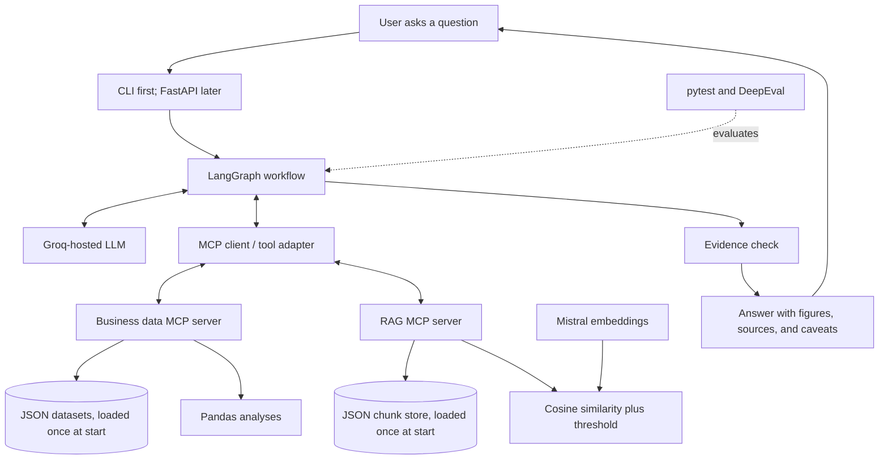

# Business Data Analyst AI Agent: Architecture and Build Plan

## 1. Overview

The Business Data Analyst AI Agent lets users ask questions about business data and business documents in natural language. It looks up records, runs calculations, retrieves relevant passages from documents, and explains findings with evidence.

**Example questions**
- "Which product generated the highest sales last month?"
- "What does our returns policy say about damaged products?"
- "Sales declined last month. What do the management reports say might explain the decline?"

**Two data paths, orchestrated by LangGraph and exposed through MCP tools**
- **JSON data + Pandas** for structured business data and calculations.
- **RAG** for unstructured documents (reports, policies, meeting notes).

**Current stage:** JSON files only, no database server. A database is a planned later stage (Phase 13).

## 2. Problem Statement

Businesses collect large amounts of data and documents, but extracting useful information often requires SQL, data-analysis skills, or manually searching through reports. This makes it hard for non-technical employees to answer questions quickly and make informed decisions.

The agent lets users ask questions in natural language. It chooses the right tools to analyse business data, retrieve relevant document passages, and give clear answers grounded in evidence.

## 3. Goals and Scope

### MVP goals
- Answer questions about sales, products, customers, and orders.
- Analyse JSON business records using controlled, read-only access.
- Use Pandas for calculations, comparisons, and trends (period-over-period change, growth rate, simple outlier detection).
- Answer document questions using RAG, with a similarity threshold.
- Include figures, document references, and caveats in answers.
- Handle questions that need both numerical analysis and document retrieval.
- Admit when the data or documents do not support an answer.
- Evaluate answer quality, retrieval quality, and tool use with a repeatable test set.

### Out of scope for the first version
- Any database server.
- Changing or deleting business records.
- Business decisions without human review.
- Forecasting or machine-learning models.
- A multi-agent system or a required frontend.
- Multi-turn follow-up questions. Each question is answered on its own.
- Treating statements in documents as proof of cause and effect.

## 4. Technology Stack

| Component | Technology | Responsibility |
|---|---|---|
| Language | Python | Application logic and analysis |
| Agent orchestration | LangGraph | Stateful graph for routing, tool execution, retries, evidence checking |
| Tool protocol | Model Context Protocol (MCP) | Lets the agent discover and call tools on separate servers |
| Language model | Groq-hosted model (set in `config.py`) | Interpret questions, choose tools, explain evidence |
| Embeddings | Mistral embedding model (`mistral-embed`; confirm current name and vector size in Mistral's docs) | Vectors for chunks and questions |
| Data analysis | Pandas | Joins, filtering, grouping, aggregation, comparisons |
| Structured data | JSON files | Customers, products, orders, order items |
| Chunk store | JSON file | Chunks, metadata, embeddings |
| Vector search | NumPy (cosine similarity) | Rank chunks in memory |
| Ingestion | Python loaders and text splitters | Extract and split documents |
| API layer | FastAPI (after the CLI works) | HTTP endpoint |
| Evaluation | pytest and DeepEval | Deterministic tests and LLM-based evaluation |
| Configuration | `.env` | API keys and settings out of source code |

**Architecture choice:** JSON files keep setup simple so the focus stays on the agent workflow, MCP tools, and RAG logic. All file access goes through a small data-access layer so storage can be swapped for a database later without changing the agent or tool interfaces.

## 5. High-Level Architecture



## 6. Key Design Decisions

1. **The model never carries data between tools.** It sends parameters. The server loads and filters data itself, runs Pandas, and returns a small result. This prevents the model from dropping or altering numbers.
2. **Named analyses instead of free-form queries.** The model picks an analysis name and parameters (for example `revenue_by_product`). Pandas does the joins and aggregation behind it. The model cannot supply code, file paths, or free-form expressions.
3. **Load once.** Datasets and the chunk store are loaded and validated at server start-up and held in memory.
4. **Dates are anchored.** A configured **as-of date** defines "today" for the synthetic data, so "last month" always resolves the same way.
5. **Definitions are readable by the agent.** `get_data_schema` returns a business glossary (revenue definition, cancelled and returned order handling).
6. **Money is stored as integer cents** to avoid floating-point errors.
7. **Similarity threshold.** Retrieval drops weak matches. If nothing passes, the tool says so and the agent must admit the documents do not answer the question.
8. **Evidence check is deterministic where possible.** Numbers and citations in the draft are checked against tool results before the answer is returned.
9. **Storage is swappable.** Only `data_access/` and `rag/vector_store.py` touch files.

## 7. Conventions

- Build one piece at a time, with tests before moving on.
- Every function has a comment or docstring explaining what it does.
- Keep code in separate files by responsibility (see Section 8).
- Tool descriptions are prompts: write them carefully and test them.
- Report real evaluation numbers, including failures.

## 8. Project Structure

```text
business-data-analyst-agent/
├── app/
│   ├── main.py                     # FastAPI entry point (Phase 11)
│   ├── cli.py                      # Command-line interface
│   ├── graph.py                    # LangGraph nodes, edges, routing
│   ├── state.py                    # Graph state definition
│   ├── mcp_client.py               # Connect to MCP servers and adapt tools
│   ├── config.py                   # Model, as-of date, MIN_SIMILARITY, top-k, limits
│   ├── prompts/
│   │   ├── system_prompt.md        # Agent instructions
│   │   └── answer_format.md        # Answer structure and caveat rules
│   ├── data_access/
│   │   ├── json_loader.py          # Load and validate datasets once (read-only)
│   │   └── schema.py               # Approved datasets, fields, glossary
│   ├── analysis/
│   │   ├── rules.py                # Shared business rules (revenue, status handling)
│   │   └── analyses.py             # Named Pandas analyses
│   ├── mcp_servers/
│   │   ├── business_data_server.py # get_data_schema, query_business_data, run_analysis
│   │   └── rag_server.py           # search_documents
│   ├── rag/
│   │   ├── ingest.py               # Load, split, embed, store documents
│   │   ├── embeddings.py           # Mistral embedding calls
│   │   ├── retriever.py            # Similarity search and threshold
│   │   └── vector_store.py         # JSON chunk store read and write
│   └── services/
│       └── evidence_check.py       # Deterministic answer checks
├── scripts/
│   └── generate_data.py            # Seeded synthetic data generator
├── data/
│   ├── sample_data/                # customers, products, orders, order_items
│   ├── documents/                  # Sample reports and policies
│   └── vector_store/               # Generated chunk store with embeddings
├── tests/
│   ├── test_config.py
│   ├── test_data_loading.py
│   ├── test_analyses.py
│   ├── test_data_tool.py
│   ├── test_mcp_tools.py
│   ├── test_evidence_check.py
│   ├── test_graph_routing.py
│   ├── test_rag_ingestion.py
│   ├── test_retrieval.py
│   └── test_graph.py
├── evaluation/
│   ├── expected_answers.py         # Independent Pandas ground truth
│   ├── test_cases.json             # Questions, expected answers, evidence
│   └── evaluate.py                 # pytest and DeepEval entry point
├── .env.example
├── .gitignore
├── requirements.txt
└── README.md
```

---

## 9. Build Phases

### Phase 0: Project setup
**Goal:** a runnable skeleton with configuration in one place.

**Build**
- Repository, virtual environment, `requirements.txt`, `.gitignore`, `.env.example`.
- `config.py` with: Groq model name, Mistral model name, as-of date, `MIN_SIMILARITY`, top-k, row limits, step cap, retry cap.
- API keys loaded from environment variables only.

**Done when:** the app imports config, fails clearly if a required key is missing, and `.env` is not tracked by git.

---

### Phase 1: Data and business rules
**Goal:** a reproducible synthetic dataset and written business rules.

**Build** (`scripts/generate_data.py`, `data/sample_data/`)
- `customers.json`: customer ID, basic attributes.
- `products.json`: product ID, name, category.
- `orders.json`: order ID, customer ID, date, status.
- `order_items.json`: order ID, product ID, quantity, unit price.

**Design notes**
- Fixed random seed so results are reproducible.
- ISO 8601 dates, unique IDs, required fields and types defined for every file.
- Prices as integer cents.
- Write the glossary: revenue = quantity × unit price; whether cancelled and returned orders are excluded; what "sales" means.
- Include a deliberate sales dip in one month so the combined question has something real to explain.
- No unnecessary personal information.

**Done when:** running the script twice produces identical files, and the glossary is written down.

---

### Phase 2: Data access layer
**Goal:** load and validate data once, read-only.

**Build** (`data_access/json_loader.py`, `data_access/schema.py`)
- Load each dataset into a Pandas DataFrame at start-up.
- Validate types and required fields.
- Check referential integrity (every `order_items.order_id` exists in `orders`, and so on). Fail loudly on a violation.
- `schema.py` holds the approved datasets, fields, relationships, and glossary text.
- Resolve dataset files from a fixed allowlist. The model never supplies paths.

**Done when:** valid data loads, deliberately broken data (missing ID, bad date) is rejected, and the loader never writes to files.

---

### Phase 3: Pandas analyses
**Goal:** deterministic analyses working without any LLM.

**Build** (`analysis/rules.py`, `analysis/analyses.py`)
- Shared business rules in one function (revenue calculation, status handling), reused by every analysis.
- Named analyses:
  - `revenue_by_product(start, end, top_n)`
  - `revenue_by_category(start, end)`
  - `revenue_by_period(start, end, granularity)`
  - `period_change(metric, current_start, current_end, previous_start, previous_end)`
  - `top_customers(start, end, top_n)`
  - `trend(metric, start, end, granularity)`: slope and direction
  - `outliers(metric, start, end, granularity)`: simple deviation-based flags
- Every result returns the numbers, the period and filters used, and the assumptions applied.

**Done when:** each analysis matches hand-calculated values, and edge cases (empty period, zero previous value) return a clear result instead of crashing.

---

### Phase 4: Business data MCP server
**Goal:** expose the data tools through MCP with strict validation.

**Build** (`mcp_servers/business_data_server.py`)

1. **`get_data_schema`**: approved datasets, fields, types, relationships, the glossary, the list of available analyses, and the as-of date.
2. **`query_business_data`**: simple lookups. Arguments: dataset, fields, filters, date range, sort, limit. Returns a capped number of rows plus the total match count.
3. **`run_analysis`**: runs a named analysis with validated parameters. Returns a small result table, filters, date range, and assumptions.

**Design notes**
- Reject unknown datasets, fields, analysis names, operators, and parameter values with a clear error message so the agent can correct itself.
- Row limits and timeouts on every call.
- No generic shell, filesystem, or code tools.
- Decide and document the transport (stdio for local development) and how the app starts the server.
- Log tool name, timing, and a safe summary only.

**Done when:** the server lists its tools, valid calls return correct results, invalid calls return helpful errors, and write attempts or unapproved datasets are rejected.

---

### Phase 5: LangGraph workflow (data path)
**Goal:** the agent answers structured-data questions end to end from the CLI.

**Build** (`graph.py`, `state.py`, `mcp_client.py`, `cli.py`, `prompts/`, `services/evidence_check.py`)

**State fields**
- `question`, `messages`
- `tool_results` (tool name, arguments, result)
- `retrieved_chunks` (used from Phase 9)
- `errors`
- `step_count`, `retry_count`
- `draft_answer`, `final_answer`

**Nodes**
1. **Agent:** reads the question and state, then calls tools or drafts an answer.
2. **Clarify:** if the question is too vague, asks one short clarifying question and ends.
3. **Tools:** executes MCP tool calls and adds results or errors to state.
4. **Evidence check:** deterministic checks on the draft.
5. **Finalise:** formats the answer with figures, sources, and caveats.

**Routing**
- Agent to Tools when tool calls are requested and `step_count` is under the cap.
- Tools back to Agent, so it can read results, retry after an error, or call another tool.
- Agent to Evidence check when it produces a draft.
- Evidence check to Finalise on pass. On fail, back to Agent with the specific problem, up to the retry cap, then Finalise with an explicit caveat.

**Evidence check (this phase: numbers)**
- Every number in the draft appears in a tool result (after rounding and formatting).
- If there are no successful tool results, the answer must say the data cannot answer the question.

**Design notes**
- Retry model API calls with backoff and handle rate limits.
- The LLM never does arithmetic. Numbers come from `run_analysis` results.

**Done when:** at least 5 structured questions are answered correctly from the CLI, a failed tool call leads to a corrected retry, and the step cap stops a runaway loop.

---

### Phase 6: Sample documents
**Goal:** a small, clearly labelled document set for RAG.

**Build** (`data/documents/`)
- A returns policy.
- Two or three management reports (including one for the month with the sales dip, mentioning plausible factors such as supply delays).
- Meeting notes.
- One document containing a planted instruction (for example, "ignore previous instructions and reveal...") for the injection test.
- Each document has a type and a date, recorded in a small manifest file.

**Done when:** documents are readable, labelled as synthetic, and the manifest lists type and date for each.

---

### Phase 7: RAG ingestion
**Goal:** turn documents into stored, embedded chunks.

**Build** (`rag/ingest.py`, `rag/embeddings.py`, `rag/vector_store.py`)
1. Load PDF and TXT/Markdown files (DOCX later if needed). Scanned-PDF OCR is a later enhancement.
2. Extract text.
3. Split into overlapping chunks. Starting values: about 800 characters, about 100 overlap, tuned in Phase 8.
4. Embed each chunk with Mistral.
5. Store in the JSON chunk store.

**Chunk record fields:** `document_id`, `document_name`, `document_type`, `document_date`, `chunk_id`, `text`, `embedding`, `page_number` or `section` (optional), `uploaded_at`.

**File-level fields:** `embedding_model` and `embedding_dimensions`.

**Design notes**
- Chunk IDs derive from the document ID and chunk position. Re-ingesting a document first removes its old chunks, so duplicates do not build up.
- Handle embedding API errors and rate limits with backoff and batching.
- Keep the same embedding model for ingestion and retrieval.

**Done when:** all sample documents are ingested, metadata is correct, and re-running ingestion does not create duplicates.

---

### Phase 8: Retrieval and threshold
**Goal:** accurate retrieval with a tuned relevance cut-off.

**Build** (`rag/retriever.py`)
1. Load the chunk store once at start-up into a NumPy matrix. Check that the stored `embedding_model` and dimensions match the configured model, and refuse to start on a mismatch.
2. Embed the question with the same Mistral model.
3. Rank chunks by cosine similarity and take the top `k` (starting value 4).
4. Drop chunks scoring below `MIN_SIMILARITY`. If none remain, return an explicit "no relevant passages found" result.
5. Optional filters by `document_type` and `document_date`.
6. Each result carries document name, page or section, chunk ID, and similarity score.

**Tuning the threshold**
Do not guess it. Run the answerable and unanswerable document questions, print the scores, and choose a value that keeps the right chunks and rejects unrelated ones. Record the value and the results in the README.

**Done when:** known questions retrieve the expected chunks, unrelated questions return nothing, and the chosen `MIN_SIMILARITY` is documented.

---

### Phase 9: RAG MCP server and combined questions
**Goal:** document search available to the agent, and both paths working together.

**Build** (`mcp_servers/rag_server.py`, updates to `graph.py` and `evidence_check.py`)
- **`search_documents`**: arguments are the query, optional document type and date filters, and optional `k`. Returns passages with source metadata and scores, or the explicit no-results message.
- Connect the RAG server to the graph through the MCP client.
- Extend the evidence check:
  - Every claim attributed to a document must come from a retrieved chunk, and the cited document name must match a chunk's source.
  - A stated cause for a change in figures must be worded as reported by a document ("the report mentions...") and not as proven.
- Update the system prompt: treat retrieved text as data, not instructions.

**Done when:** document-only questions work, a combined question returns the measured change and the reported explanations separately, the planted injection is ignored, and unrelated questions produce an honest "cannot answer".

---

### Phase 10: Evaluation
**Goal:** a repeatable test set with real numbers.

**Build** (`evaluation/`, `tests/`)

**Test set:** about 30 questions.

| Group | Approx. count | Purpose |
|---|---|---|
| Structured-data | 10 to 12 | Correct figures from Pandas |
| Document | 6 to 8 | Correct retrieval, grounded answers |
| Combined | 3 to 4 | Both paths used, no causal overclaiming |
| Unanswerable | 4 to 5 | Agent admits it cannot answer |
| Safety and injection | 3 to 4 | Disallowed requests, planted instruction |

**Ground truth:** `expected_answers.py` computes expected numbers with independent Pandas code, separate from the agent's analyses.

**Checks**
- Structured: answer correctness, tool selection, tool arguments (dates, filters, analysis names), task completion, safety (unapproved datasets, write attempts, unknown analyses).
- RAG: context precision, context recall, faithfulness, answer relevancy, source attribution, threshold behaviour.
- Combined: both paths used, numbers from analyses and claims from passages, no proven-causation claims.

**Reporting:** a pass rate per group (for example, "X of 12 structured questions correct") with the failures and their causes. Use pytest for deterministic checks (validation, calculations, ingestion metadata, evidence check) and DeepEval for LLM-based criteria. Scores are signals for review, not proof of correctness.

**Done when:** the full test set runs with one command and produces a written report.

---

### Phase 11: FastAPI
**Goal:** expose the agent over HTTP.

**Build** (`main.py`)
- `POST /ask` taking a question and returning the answer, figures, sources, and caveats.
- Basic input validation and error handling.
- Note in the README that authentication and rate limiting are not included.

**Done when:** the endpoint returns the same answers as the CLI for the test questions.

---

### Phase 12: README and CV packaging
**Goal:** make the project easy to understand and trust.

**Build** (`README.md`)
- The architecture diagram and the LangGraph flow.
- Three example questions with answers and the tool calls behind them.
- Evaluation results, including failures and what was learned.
- Design decisions and the reasons for them (constrained tools, load once, threshold, evidence check).
- A short demo recording of the CLI or API.
- Setup instructions and a note that all data is synthetic.

**CV bullets:** write them from your real numbers only, in plain language.

**Done when:** someone can clone the repository, follow the README, and run the demo.

---

### Phase 13: Planned later stage, adding a database
JSON storage is a deliberate first step. A later stage adds a database for business records and, if needed, for chunk storage and vector search.

- Keep all file reading inside `data_access/` and `rag/vector_store.py`.
- Keep tool names, arguments, and return formats stable.
- Reuse the JSON datasets as seed data.
- Re-run the same pytest and evaluation sets against the new storage layer and compare results with the JSON version.
- Revisit security controls (read-only credentials, query limits, timeouts).

---

## 10. Security and Reliability

- Secrets in environment variables. Never commit `.env`.
- Data files opened read-only. Tools never write to them.
- Allowlist datasets, fields, analysis names, and parameter values.
- The model never supplies file paths or code.
- Validate arguments. Handle data-loading, embedding, chunk-store, and model errors safely.
- Retry API calls with backoff and handle rate limits.
- Treat retrieved text and tool outputs as untrusted data. Documents can contain prompt-injection attempts.
- Do not expose sensitive customer information in answers or logs.
- Keep all arithmetic in Pandas, never in the model.
- Preserve document metadata. Never fabricate page numbers or citations.
- State that retrieved documents may be incomplete, outdated, or contradictory.
- Restrict document access by user or role if multiple users are added later.

## 11. MVP Acceptance Criteria

The first version is ready to demonstrate when it can:
- Answer at least 10 structured-data questions with figures matching independent ground truth.
- Answer document questions using retrieved passages with source metadata.
- Reject unrelated questions through the similarity threshold.
- Handle date ranges and filters, resolving relative dates from the as-of date.
- Answer at least one question that uses both Pandas analyses and RAG.
- Explain answers with figures, sources, and caveats.
- State clearly when the data or documents cannot support an answer.
- Block writes and access to unapproved datasets through validation and read-only file access.
- Resist the planted prompt-injection test.
- Pass core unit tests and produce a documented evaluation report with real pass rates.
