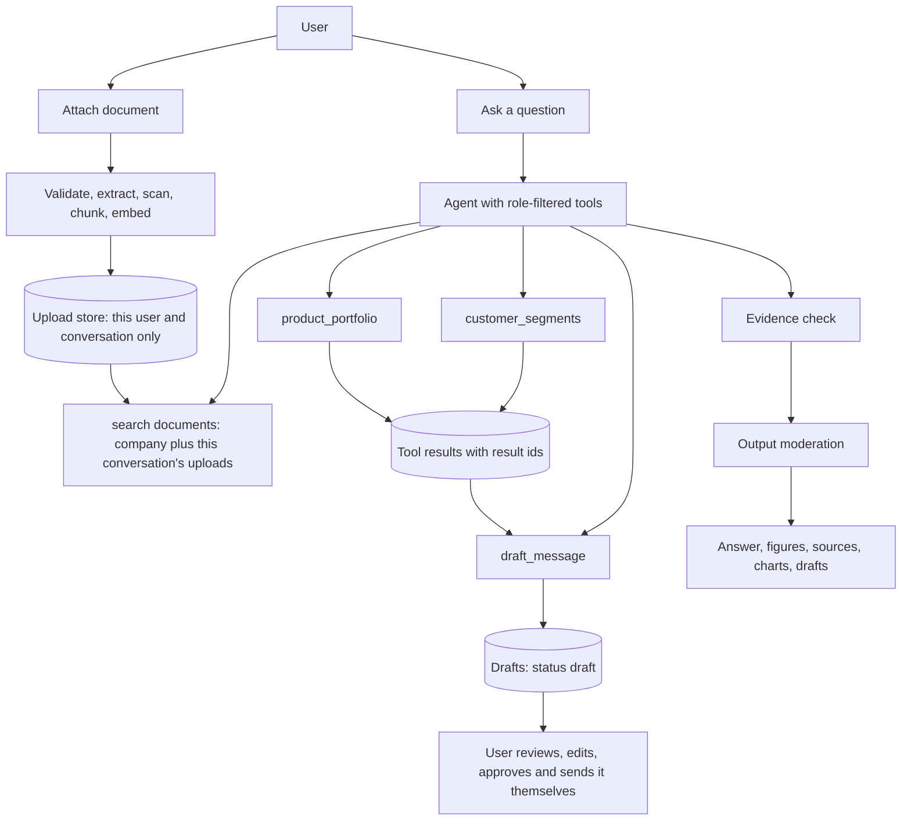
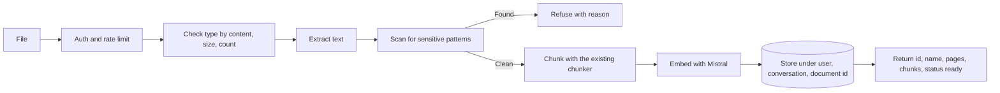

# Feature Spec: Customer Segments, Product Portfolio, Draft Messages and Document Context

This update makes the Business Analyst AI do more than report numbers. It adds four things:

1. **`customer_segments`**: groups customers by how recently, how often and how much they buy, with plain names and a suggested next step per group.
2. **`product_portfolio`**: shows how concentrated sales are, which products carry the business, what is rising or falling, and the long tail.
3. **`draft_message`**: writes a draft email or summary from the analysis results. It never sends anything. A person reviews, edits and approves it.
4. **Document context**: users can attach documents to a chat, ask questions about them, and have them feed into answers and reports. A reviewer suggested this, and it makes reports richer because the numbers can be read next to what the business has written down.

Read the existing code and the README first, then tell me what you found before changing anything (Step 0).

## 1. How to work

- Build one step at a time (Section 10). After each step, stop, show what changed, and wait for my confirmation.
- Before writing code for a step, explain in a few sentences what you will do and why.
- One responsibility per file. Do not bundle code or scaffold everything at once.
- Every function gets a comment or docstring saying what it does.
- Keep explanations short and practical.
- I run commands myself on Windows in PowerShell, so give me commands I can paste.
- Check the current documentation before using any library: FastAPI file uploads (needs `python-multipart`), `pypdf`, `python-docx`, scikit-learn (only if the optional K-means step is built), and the chart library. Their APIs change.
- If something here conflicts with how the existing code works, stop and ask. Do not guess.
- Do not add features that are not in this spec.

## 2. Assumptions about what already exists

The earlier update (access control, moderation, charts, decline risk) is either built or being built. This spec relies on these pieces. Step 0 checks each one.

| Piece | How this spec uses it |
|---|---|
| Login, roles, the policy module | New tools and fields are added to the policy. Nothing new is allowed by default. |
| Moderation (input, output, retrieved text) | Applies to drafts, uploads and answers about uploads. |
| Audit log | New events are logged (Section 8.6). |
| Named analyses through `run_analysis` | The two new analyses plug in here. |
| Chart spec and builders | New default charts use the existing spec. |
| Evidence check on numbers and document quotes | Extended for uploaded documents and drafts. |
| Money in integer cents, `AS_OF_DATE` | All new money values follow this. |
| The document store (chunks, Mistral embeddings, `MIN_SIMILARITY`, `TOP_K`) | Uploads reuse the same chunker, embedder and threshold. |

If any of these is missing, tell me which and wait.

## 3. Principles

1. **Numbers come from code.** Segments, shares, growth and concentration are computed with Pandas. The model writes the words around them.
2. **Documents are context, not truth.** A document can say sales fell because of a supplier problem. That is a claim. The agent reports it as "the document states", checks it against the data when it can, and never presents it as proven.
3. **Uploads never grant access.** An uploaded file is visible only to the person who uploaded it, in that conversation. It cannot change a role, a policy or a tool's behaviour.
4. **A draft is not a decision.** The system writes drafts. People send them. There is no code path that sends a message.
5. **Segments are descriptions, not predictions.** "At risk" means the customer's pattern looks like one that is fading. It does not mean they will leave.
6. **No numbers invented by the model.** In a draft, every figure is a placeholder filled in by code from a real result.
7. **Enforce in code.** Role checks, file limits, moderation and the "no send" rule are code, not prompt wording.
8. **Fail closed.** If extraction, moderation or a policy check fails, the result is refused, not partly shown.
9. **Config over code.** Thresholds, segment rules, draft purposes and file limits live in JSON files.

## 4. How the pieces fit



## 5. Feature 1: `customer_segments`

### 5.1 What it answers

- "Who are our best customers, and how much of revenue do they make?"
- "Which valuable customers have gone quiet?"
- "How is revenue split across customer groups?"
- "Show me the at-risk customers."

### 5.2 Method: RFM (the default)

RFM is easy to explain and to check, which matters more here than a clever model.

For each customer, over a **window** (default 12 months ending at `AS_OF_DATE`):

- **Recency**: days since the customer's last counted order, as of `AS_OF_DATE`.
- **Frequency**: number of counted orders in the window.
- **Monetary**: total revenue (integer cents) from counted orders in the window.

"Counted orders" means the same order statuses the existing revenue analyses count. **Reuse the existing status filter. Do not write a second one.** If there is none shared, tell me and propose one.

Scoring, 1 to 5 each, using quintiles:

- Recency is inverted: fewer days since the last order gives a higher score.
- Use `rank(method="first")` before `qcut` so tied values do not crash it or make uneven bins.
- If there are fewer than `min_customers` (default 30) customers with orders in the window, return `status: "insufficient_data"` with a caveat. Do not force quintiles onto a tiny list.

### 5.3 Segment rules (starting values, put in `config/segments.json`)

First match wins, so every customer lands in exactly one segment.

| Order | Segment | Rule | Plain meaning |
|---|---|---|---|
| 1 | New | First ever order is within `new_days` (default 60) of the as-of date | Recently acquired |
| 2 | Best customers | R ≥ 4 and F ≥ 4 and M ≥ 4 | Recent, frequent, high value |
| 3 | Loyal | R ≥ 3 and F ≥ 3 | Buy regularly and recently |
| 4 | At risk | R ≤ 2 and F ≥ 3 | Used to buy often, have gone quiet |
| 5 | Lost | R = 1 and F ≤ 2 | Long quiet, never bought often |
| 6 | Occasional | Everyone else | Buy now and then |

The thresholds are starting values to calibrate against the real data. Keep them in the config file, not in code.

Each segment in the config also carries:

- `meaning`: one plain sentence.
- `suggested_next_step`: one plain sentence, written by me or by you for me to approve (examples in Appendix A). **The model does not invent next steps.** It reads them from the config.
- `owner_role`: who would normally act (for example `sales`).

### 5.4 Output

```json
{
  "status": "ok",
  "as_of": "2025-01-15",
  "window": {"start": "2024-01-16", "end": "2025-01-15", "months": 12},
  "method": "rfm",
  "customers_counted": 0,
  "segments": [
    {
      "name": "At risk",
      "meaning": "...",
      "customers": 0,
      "share_of_customers": 0.0,
      "revenue_cents": 0,
      "share_of_revenue": 0.0,
      "avg_order_value_cents": 0,
      "avg_days_since_last_order": 0,
      "avg_orders": 0.0,
      "suggested_next_step": "...",
      "owner_role": "sales",
      "top_customers": [{"customer_id": "...", "name": "...", "revenue_cents": 0, "days_since_last_order": 0}]
    }
  ],
  "revenue_at_stake_cents": 0,
  "caveats": []
}
```

Rules for the output:

- `top_customers` is capped (default 10) and sorted by revenue. Show `name` only if the role's policy allows that field. Otherwise show the customer ID only.
- `revenue_at_stake_cents` is the window revenue of the **At risk** segment. It is revenue that comes from customers who are quiet now. It is **not** a forecast and must be worded as "revenue linked to customers who have gone quiet".
- Segment customers add up to `customers_counted`, and segment revenue adds up to the window revenue. Exactly.
- Caveats are added for: a window longer than the available history, a segment with fewer than 5 customers (percentages shaky), an incomplete latest month, and `insufficient_data`.

### 5.5 Parameters

`run_analysis(name="customer_segments", params={...})`

| Param | Default | Notes |
|---|---|---|
| `window_months` | 12 | 3 to 24 |
| `segment` | none | If set, return only that segment, with up to `top_n` customers |
| `top_n` | 10 | Max 25 |
| `method` | `"rfm"` | `"kmeans"` only if the optional step is built |

Validate every param. An unknown segment name gives an error that lists the valid names.

### 5.6 Default chart

A horizontal bar chart of revenue share by segment, ordered from largest to smallest, with customer counts in the labels. Use the existing chart spec. Do not add a chart type without asking me.

### 5.7 Optional later: K-means variant

Only after RFM works and I confirm. Same inputs, with log-scaled R, F and M, standardised, `KMeans` with a fixed `random_state` and `k` from config (default 4). Name clusters by ranking centroids on monetary value and recency. Show it as a second view with a caveat that cluster names are descriptive. RFM stays the default because every customer's group can be explained in one sentence.

## 6. Feature 2: `product_portfolio`

### 6.1 What it answers

- "How dependent are we on our top products?"
- "Which products are growing or shrinking?"
- "How many products make 80% of revenue?"
- "Which products are not selling at all?"
- "Which category carries the most revenue, and how has that changed?"

### 6.2 Inputs

`run_analysis(name="product_portfolio", params={...})`

| Param | Default | Notes |
|---|---|---|
| `level` | `"product"` | `"product"` or `"category"` |
| `window_months` | 12 | 1 to 24 |
| `compare` | `"previous_period"` | Same length window directly before. `"none"` skips the comparison |
| `top_n` | 10 | Max 25 for lists |

### 6.3 What to compute

For each product (or category) in the window:

- Revenue (cents), share of total revenue, units sold, number of orders, average selling price (revenue ÷ units, cents).
- Rank and cumulative share, ordered by revenue.
- **Class** by cumulative share (config): A = the products that make the first 80% of revenue, B = the next 15%, C = the last 5%.
- When comparing: previous revenue, change in cents, change in percent, previous rank, rank change, change in units, change in average price.

Portfolio-level figures:

- Top 1, top 3 and top 5 share of revenue.
- Number of products that make 80% of revenue, out of the total products with sales.
- **HHI** (Herfindahl index): sum of squared revenue shares, scaled 0 to 10,000. Give it a plain label from config bands (for example low, moderate, high concentration). Always show the top 3 share next to it, since the index alone means little to most readers.
- Long tail: count and combined revenue share of products below `tail_share` (default 1%).
- **Dormant products**: in the product master but with no counted sales in the window.
- **New products**: no revenue in the previous period, revenue now.
- **Dropped products**: revenue in the previous period, none now.

### 6.4 Movers

- Rank movers by **change in cents**, not percent, so a tiny product doubling does not top the list. Top `top_n` risers and top `top_n` fallers.
- Show a percent change only if the previous revenue is at least `min_base_cents` (config). Otherwise show "n/a (small base)".
- For each mover, show the units change and the average price change next to the revenue change. This tells the reader whether the move came from volume or price. Present it as **description**, not a cause.

### 6.5 Observations (config-driven, not model-invented)

A small list of rules in `config/portfolio.json`. Each rule has a condition on the computed figures and a fixed sentence. Starting examples:

- Top 3 share above 60%: "A small number of products carry most of the revenue. A problem with one of them would be felt across the business."
- A class A product with a revenue fall of more than 15% against the previous period: "A major product is selling less than before. Worth looking at before the next period closes."
- More than 20% of products in the long tail: "Many products contribute very little. Review whether all of them are needed."
- Any dormant products: "These products had no sales in the period."

The agent may quote these sentences. It must not add its own conclusions about causes. For "why", it uses the existing decline and document tools, or recommends a data analyst.

### 6.6 Output shape

Same pattern as segments: `status`, `as_of`, `window`, `level`, `portfolio` (the headline figures), `items` (capped ranked list), `movers` (`risers`, `fallers`, `new`, `dropped`), `dormant`, `observations`, `caveats`.

Rules:

- Item revenues add up to the window revenue. Shares add up to 1, allowing for rounding that you handle once, in one place.
- The comparison window has the same number of days as the current one. If the previous window starts before the first order in the data, add a caveat and mark changes as partial. Do not compute a misleading change.
- Caveat when the latest month is incomplete.

### 6.7 Default charts

- Ranked horizontal bar of revenue by product, with share in the label.
- Diverging bar of change in revenue for the top risers and fallers.
- If the existing chart spec supports a combined bar and cumulative line, use it for the Pareto view. If not, show the ranked bar and put cumulative share in the table. Ask before extending the spec.

## 7. Feature 3: `draft_message`

### 7.1 What it is

A tool that turns analysis results into a short draft message for a person to review. Examples:

- A follow-up note for an account owner about a customer in the At risk segment.
- A summary for a manager about a product that is falling.
- A question for a supplier about a product that sells strongly.

It produces **text for a human**. It does not send email, post to chat, or contact anyone. Do not add any library or code that sends messages.

### 7.2 Purposes (starting list, in `config/draft_purposes.json`)

| Purpose | Roles allowed | Facts it may use | Typical audience |
|---|---|---|---|
| `customer_followup` | sales, manager | A segment result, or a customer in one | Account owner or the customer |
| `product_update` | sales, manager | A product portfolio result | Team or manager |
| `supplier_inquiry` | sales, manager | A product portfolio result | Supplier contact |
| `management_summary` | sales, hr, manager | Any permitted result in this conversation | A manager |

Each purpose defines: allowed roles, allowed result types, required fields, maximum length (default 150 words), allowed tones (`formal`, `friendly`, `brief`), and whether it has a subject line.

A role cannot create a purpose it is not allowed. HR users cannot draft from sales results, because the facts come only from results the role is permitted to see.

### 7.3 Inputs

```json
{
  "purpose": "customer_followup",
  "subject_ref": {"type": "customer", "id": "C-0042"},
  "source_result_ids": ["r_17"],
  "audience": "account owner",
  "tone": "friendly",
  "notes": "mention the quiet period, keep it short"
}
```

- `source_result_ids` point to tool results already produced **in this conversation, for this user**. The tool refuses any ID that is not theirs.
- `audience` is a short label, not an email address. The system never stores or fills in addresses.
- `notes` is limited to 300 characters and treated as untrusted text, like any user message.
- Check how tool results are stored today. If they have no stable `result_id`, add one (Step 0 reports on this).

### 7.4 How the draft is written (the safe way)

1. **Code builds the facts block** from the referenced results: a list like `F1: customer name`, `F2: days since last order = 61`, `F3: revenue in the last 12 months = $4,210.00`. Each fact has an ID.
2. **The model writes the draft using only fact IDs**, for example "It has been {{F2}} days since your last order." It may not write any digit of its own.
3. **Code fills the placeholders** with the real values, formatted by the existing money and date helpers.
4. **Digit guard:** after the model writes and before filling, reject any text that contains a digit outside a placeholder (a small allowed list in config handles things like "3pm"). Retry once. If it fails again, use the plain template for that purpose (a fixed sentence structure in config) and add a warning.
5. **Content checks (output moderation):**
   - No promises or commitments (discounts, prices, delivery dates, refunds, guarantees) unless they come from a fact placeholder.
   - No names or figures that are not in the facts block.
   - No threats, pressure or blame language. Customer drafts stay polite.
   - Nothing the role may not see.
6. The draft is stored with status `draft` and returned.

Sender and recipient details stay as visible brackets for the person to fill in, such as `[Your name]`. The model is not given the user's name or contact details.

### 7.5 Draft object and lifecycle

```json
{
  "draft_id": "d_5",
  "conversation_id": "...",
  "purpose": "customer_followup",
  "subject_line": "...",
  "body": "...",
  "facts_used": [{"id": "F2", "label": "Days since last order", "value": "61", "result_id": "r_17"}],
  "warnings": [],
  "status": "draft",
  "created_at": "...",
  "edited": false
}
```

Statuses: `draft` → `approved` (the user marked it ready) or `discarded`. **"Approved" only means the person says it is ready. The system still sends nothing.** The frontend gives a copy button.

Endpoints (all need login, and a user can only touch their own drafts):

- `GET /drafts?conversation_id=` list.
- `GET /drafts/{id}` one draft.
- `PATCH /drafts/{id}` edit the body or subject, or set the status. An edit re-runs the content checks (not the digit guard, because the person is free to type numbers). Mark `edited: true`.
- No `POST /drafts/{id}/send`. A test will assert there is no such route.

### 7.6 Limits

- At most 10 drafts per conversation per hour and a per-user daily cap (config).
- Draft length capped by purpose.
- Every draft carries a visible line: "Draft, not sent. Review before using."

## 8. Feature 4: Document context

### 8.1 What the user gets

- An attach button in the chat. The user adds one or more documents (a strategy note, a targets sheet, a promotion plan, a management report, a supplier email saved as PDF).
- They ask questions about the document ("what are our targets for Q1?"), or ask questions about the business and the agent uses the document as context.
- Reports include a short section "What your documents say", with quotes and source names, next to the numbers from the data.
- The agent can compare a claim in a document with the data ("the plan says revenue grew 10%; the data shows 6.2%"). It reports both and does not pick a winner.

### 8.2 Supported files and limits (config in `config/uploads.json`)

| Setting | Starting value |
|---|---|
| File types | PDF (with text), DOCX, TXT, MD |
| Max size per file | 10 MB |
| Max files per conversation | 5 |
| Max chunks per file | 300 |
| Uploads per user per day | 20 |
| Retention | Deleted with the conversation, or after 30 days |

Not supported in this version (say so clearly in the UI): scanned PDFs with no text, images, spreadsheets and CSVs. Spreadsheets are data, not documents, and belong to a different feature. If a PDF has no extractable text, return a clear message, not a silent empty file.

### 8.3 Upload flow



Details:

- **Check type by content, not extension.** PDFs start with `%PDF-`. DOCX files are zip files with the expected parts. Reject anything else.
- **Safe storage.** Save under a generated name in `data/uploads/{user_id}/{conversation_id}/{document_id}/`. Never use the user's filename as a path. Keep the display name as sanitised text only.
- **Extraction:** `pypdf` for PDFs, `python-docx` for DOCX, plain read for TXT and MD. Record page numbers for PDFs so quotes can cite them.
- **Sensitive pattern scan at ingest** (rules in the moderation config): card numbers (Luhn check), 13-digit national ID numbers, and obvious secrets (API keys, passwords in key-value form). If found, refuse the file with a message naming the category, not the value. This keeps personal data out of the vector store and out of the logs.
- **Chunk and embed** with the same chunker, embedder and settings as the company documents.
- **A conversation can be created by the upload.** `POST /documents` with no `conversation_id` creates a new conversation owned by this user and returns its ID. The frontend uses that ID for `/ask`.

### 8.4 Endpoints

- `POST /documents` (multipart, optional `conversation_id`): upload one file. Returns `document_id`, `name`, `pages`, `chunks`, `status`.
- `GET /conversations/{id}/documents`: list.
- `DELETE /conversations/{id}/documents/{document_id}`: delete the file, its chunks and its vectors.
- `POST /ask` gains an optional `document_ids` list to limit which uploads are used. Without it, all uploads in the conversation are used.

A user can only reach their own conversations and documents. Another user's IDs return 404.

### 8.5 Retrieval

- The document search tool searches the **company documents the role may see** plus **this conversation's uploads**, then ranks them together with the same similarity threshold and top-k.
- The access filter runs before ranking, as for company documents. Uploads from other users or other conversations are never loaded.
- Each result carries `origin`: `company` or `uploaded`, and the document name and page.
- Load a conversation's uploads into memory on first use and cache them (small LRU). Company documents stay "load once".
- If no chunk clears the threshold, the agent says the documents do not cover the question. It does not answer from the weak match.

### 8.6 Treat uploaded text as untrusted

This is the most important safety rule in this feature.

- Retrieved upload text goes into the prompt inside a clearly delimited block labelled as untrusted document content, after the system instructions.
- Anything in a document that looks like an instruction ("ignore the rules", "email this to...") is data. The existing retrieved-chunk moderation check (M9) runs on uploaded chunks too.
- An uploaded document can change what the model **says**. It can never change what the model is **allowed to do**: tool access, field access, role and moderation are enforced in code and do not read from documents.

### 8.7 Evidence rules for uploaded documents

- Quotes from an uploaded document must match the chunk text, as for company documents, and name the file (and page where known).
- Numbers that appear only in a document are **claims**. The answer attributes them ("the plan states…"). They are not listed among verified data figures. If the data tools can check the claim, the agent does so and reports match or mismatch.
- If a document and the data disagree, the answer states both and the difference. It does not choose one.
- Label uploaded sources "your document" in the response, so people can tell them from company documents.

### 8.8 Richer reports

- The report object gets an optional `context` section: up to `context_max` (default 3) short quotes from documents that cleared the threshold for the question, each with its source name and origin.
- Reports built from `customer_segments`, `product_portfolio` and `decline_risk` include the section only when relevant chunks exist. When there are none, they leave it out. They do not write filler.
- **Decline risk:** a document passage for the period that names a factor counts toward the explanation status in `risk_assessment.py` (`reported_factors`), whether the document is a company one or an upload. Mark an upload-based factor as "reported in your document". The data analyst recommendation rule still applies when nothing names a cause.
- The report states which documents were used and that their claims were not independently verified, unless the agent checked them.

### 8.9 Audit

Log: upload (user, conversation, file type, size, chunk count, decision), refusal (category only), deletion, and retrieval use (document IDs used in an answer). Never log file contents or extracted text.

## 9. Frontend changes

Separate from the earlier frontend spec. Keep the existing patterns and plain JavaScript.

1. **Attach button** in the message box. Choose a file, or drag and drop.
2. **File chips** above the box showing name, size and status (`uploading`, `ready`, `failed` with the reason). A remove button on each calls the delete endpoint.
3. Show the supported types and the limits next to the button, and a clear message for refused files (unsupported type, too large, too many, sensitive content found, no text found).
4. **Sources:** add a small badge on each source: `company` or `your document`. Show page numbers where present.
5. **Segment and portfolio results:** reuse `ChartCard` and the existing figures list. Add a small table component for segment and mover rows if one does not exist.
6. **`DraftCard`:** shows subject and body in an editable text area, the facts used, any warnings, and the line "Draft, not sent". Buttons: Copy, Save edits, Mark approved, Discard. No send button.
7. **Documents panel:** a list of this conversation's documents with a delete option.
8. A new user or conversation never shows another user's files or drafts. Logout clears them.

## 10. Build steps

Each step has a check. Do not start the next until I confirm.

**Step 0: Review only (no code changes)**
Read the code and report: which of the Section 2 pieces exist and where; how `run_analysis` registers analyses; the status filter used for "counted orders"; how tool results and figures are stored and whether they have stable IDs; what the chart spec supports; how document chunks and metadata are stored and searched; the sample data size (customers, products, orders, date range); and anything in this spec that conflicts with the code.
Check: a short written report. Nothing is changed.

**Step 1: Config, policy and data check**
Add `segments.json`, `portfolio.json`, `draft_purposes.json` and `uploads.json`. Add the new tools and output fields to the policy with a classification. Check the sample data is big enough for 30+ customers and many products with some history in the previous window. If it is not, propose a small data extension and wait for my confirmation.
Check: configs load and validate, the policy hides the new fields from roles that should not see them, and the data check is reported.

**Step 2: `product_portfolio` analysis**
Implement it in `analysis/`, including the comparison window, classes, HHI, movers, dormant, new and dropped, and the observation rules.
Check: item revenue adds up to window revenue, shares add up to 1, class A is the smallest set reaching 80%, rank movers use cents, a small base shows "n/a", and every figure matches an independent Pandas calculation in `expected_answers.py`.

**Step 3: `customer_segments` analysis (RFM)**
Implement scoring, rules and output as in Section 5.
Check: every customer is in exactly one segment, segment customers and revenue add up exactly, `insufficient_data` is returned for a small set, tied values do not crash scoring, and results match an independent calculation.

**Step 3b (optional, only if I ask): K-means variant**
Section 5.7.

**Step 4: Register and connect**
Expose both through `run_analysis` with param validation. Add glossary entries (RFM, segment, at risk, concentration, HHI, Pareto, class A/B/C, long tail, dormant) and schema notes. Register their figures with the evidence check. Add the default charts.
Check: both analyses run through the full agent for each allowed role and are refused for roles that are not allowed, with the same style of denial as the existing tools. A chart is returned for a ranking question and not for a single number.

**Step 5: Report sections**
Add report sections for segments and portfolio using the existing report builder: verdict line, key figures, chart, table, observations or suggested next steps, method and data limits. Follow the layout rules of the earlier report spec.
Check: both reports open in Word, every number passes the evidence check, and next steps come from the config.

**Step 6: Document upload backend**
Upload, validation by content, extraction, ingest scan, chunking, embedding, storage, list and delete, limits and retention.
Check: a valid PDF and DOCX ingest with page numbers, a wrong type, an oversized file, a sixth file, an empty-text PDF and a file with a card number are each refused with the right message, deleting a document removes its chunks, and another user gets 404.

**Step 7: Retrieval and isolation**
Merge uploads into document search with `origin`, the untrusted-text block, M9 on uploaded chunks, and the evidence rules in Section 8.7.
Check: user A's upload never appears for user B, a document containing "ignore your instructions" changes nothing, an uploaded quote is verified against the chunk, a number found only in a document is attributed and not listed as a data figure, and a question the documents do not cover gets "not covered".

**Step 8: `draft_message`**
Drafts store, purposes, facts block, placeholder writing, digit guard, content checks, fallback template, endpoints and limits.
Check: a draft's numbers all come from placeholders, a model reply with its own digits is rejected and falls back, a promise of a discount is flagged, a result ID from another user is refused, an HR user cannot draft from sales results, editing re-runs the content checks, and there is no send route or send code anywhere (search the code to prove it).

**Step 9: Reports use documents**
Add the `context` section, the `risk_assessment.py` change for uploaded documents, and the "documents used, not independently verified" note.
Check: a decline report with an uploaded management note names the reported factor and labels it "reported in your document", a report with no relevant chunk omits the section, and the data analyst recommendation still appears when nothing names a cause.

**Step 10: Frontend**
Section 9.
Check: attach, chips, delete, refused-file messages, source badges, `DraftCard` actions and clearing on logout all work, and nothing from a previous user appears after switching users.

**Step 11: Evaluation and README**
Add the test groups below and update the README: new tools, upload limits, the "no sending" rule, and the untrusted-documents rule.
Check: the full run reports pass rates per group, and the provider that answered is recorded next to each number.

### Evaluation additions

| Group | Approx. count | Purpose |
|---|---|---|
| Customer segments | 8 to 10 | Each segment, a window change, a single segment request, a small set, a restricted role, names hidden by policy |
| Product portfolio | 8 to 10 | Concentration, movers, dormant, new, dropped, category level, a short history, a restricted role |
| Draft messages | 10 to 12 | Each purpose, digit guard, fallback, forbidden promise, wrong role, foreign result ID, edit re-check, no send route |
| Document context | 12 to 15 | Upload rules, isolation between users, injection text, quote check, claim versus data, "not covered", delete |
| Reports with context | 4 to 5 | Quote shown with source, no filler when nothing is relevant, analyst recommendation preserved |
| Conversation chains | 4 to 5 | Upload then question, segment then draft, portfolio then a "why" question, user switch, refusal then valid follow-up |

I can write these as full test cases when you are ready.

## 11. New files (additions to the project)

    app/
      analysis/    segments.py, portfolio.py, segment_playbook.py
      documents/   upload_routes.py, validate.py, extract.py, scan.py, upload_store.py, limits.py
      drafts/      purposes.py, facts.py, writer.py, guard.py, draft_store.py, draft_routes.py
    data/
      config/      segments.json, portfolio.json, draft_purposes.json, uploads.json
      uploads/     (created at runtime, ignored by git)
    frontend/src/
      components/  AttachButton.jsx, FileChip.jsx, DocumentsPanel.jsx, DraftCard.jsx, SegmentTable.jsx
      hooks/       useDocuments.js, useDrafts.js

Reuse existing modules for chunking, embedding, policy, moderation, audit, charts and report building. Do not copy them.

## 12. Decisions I made (please confirm or change)

1. RFM is the default method because each customer's group can be explained in one sentence. K-means is an optional second view.
2. Segment rules and thresholds are starting values to calibrate on the real data.
3. `revenue_at_stake` is described as revenue linked to quiet customers, not a forecast.
4. Portfolio movers are ranked by change in cents, and percentages are hidden on small bases.
5. Observation and next-step sentences come from config, not from the model.
6. Drafts are text only. The system never sends, and "approved" only records the person's own judgement.
7. The model may not write digits in a draft. Figures are placeholders filled by code.
8. Draft recipients are not stored or filled in. Sender and recipient stay as brackets.
9. Uploads are limited to text PDFs, DOCX, TXT and MD, 10 MB, 5 per conversation.
10. Uploaded files are private to the uploader and the conversation. A user may upload a file their role would not normally receive from the system, because they already hold it, but the answer is still checked by output moderation.
11. Files with card numbers, national ID numbers or secrets are refused at upload.
12. Claims found only in documents are attributed and not treated as verified figures.
13. Uploaded documents count toward the decline explanation status, labelled "reported in your document".
14. Retention is 30 days or until the conversation is deleted.

## 13. Out of scope

Sending email or any message, storing contact details, scanned or image documents (OCR), spreadsheets and CSV uploads, shared team document libraries, document versioning, automatic action items and scheduled digests (later features), customer-level pricing or discount suggestions, forecasting, K-means unless requested, and production hardening such as virus scanning.

---

## Appendix A: Segment config example (illustrative text)

The sentences below are examples of the wording style. The numbers are not data.

| Segment | Meaning | Suggested next step | Owner |
|---|---|---|---|
| Best customers | Buy recently, often and in high value. | Keep service strong and check in on their plans for the coming months. | sales |
| Loyal | Buy regularly and recently. | Keep in regular contact and look for products they do not buy yet. | sales |
| New | First order was recent. | Follow up after the first order and check they are happy. | sales |
| At risk | Used to buy often but have gone quiet. | Contact them personally and ask if anything has changed. | sales |
| Lost | Quiet for a long time and never bought often. | Decide whether a single win-back message is worthwhile. | sales |
| Occasional | Buy now and then. | No action needed. Watch for a change in pattern. | sales |

## Appendix B: Sample customer follow-up draft (layout example)

Values marked † are placeholders filled by code from a real result. The model writes only the words around them.

    Draft, not sent. Review before using.

    Subject: Checking in

    Hi [Customer name],

    It has been {{F2}}† days since your last order with us, and we wanted to
    check that everything is going well. Over the last 12 months you ordered
    {{F4}}† times, and we value that.

    If anything has changed on your side, or there is something we could do
    better, I would be glad to hear it.

    Kind regards,
    [Your name]

    Facts used: F2 days since last order, F4 orders in the last 12 months
    (from result r_17)

## Appendix C: Sample portfolio summary (layout example)

Figures marked † come from the analysis. Nothing here is real data.

    Product Portfolio, last 12 months to 15 January 2025

    Verdict: Revenue is concentrated in a few products.

    Key figures
    - Top 3 products: †% of revenue
    - Products making 80% of revenue: † of †
    - Concentration (HHI): † (moderate)
    - Dormant products: †

    Chart: ranked revenue by product

    Biggest movers against the previous 12 months
    | Product | Revenue now | Change | Units change | Avg price change |
    | † | † | † | † | † |

    Worth a look
    - A major product is selling less than before. (observation rule)

    Method and data limits
    - Window, comparison window, counted order statuses, incomplete latest month.
